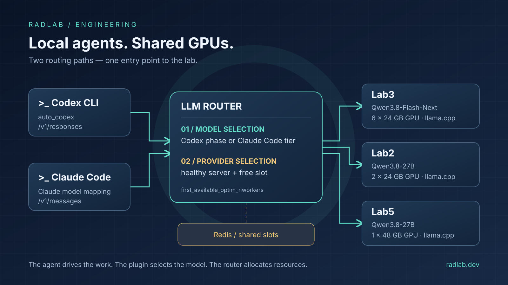

Hello! Today we are getting technical. In our [previous post about LLM Router](/en/2025-10-13/llm-router/), we showed how to separate an application from the location where its model runs. This time we are adding another building block: **the application does not even need to decide which model should handle a particular stage of work**.

A coding agent does not do the same thing all day. It plans a change, reads code, edits files, runs tests and diagnoses failures. Along the way, it generates a conversation title and, when the context fills up, prepares a summary. Sending everything to one model is simple, but rarely makes the best use of local GPUs.

In the [llm-router-plugins](https://github.com/radlab-dev-group/llm-router-plugins) repository, we develop two plugins that approach this problem from different angles: `agentic_routing_codex` and `agentic_routing_claude_code`. Below, we explain what they actually do, how to run them and how we use three machines in our lab to support them. Without pretending that changing a model name turns a local Qwen into a cloud-hosted Claude or an OpenAI model 🙂

## Login: let’s get the names straight

For Codex, the name is literal: **`auto_codex` is the default trigger name** that the client sends in the `model` field. The plugin identifies the request type and work mode, then replaces that name with a specific model.

Claude Code works differently. When we use “auto_claude” as shorthand, we mean automatic mapping of Claude Code models, but **the supplied configuration has no special `auto_claude` trigger**. The plugin recognizes model names and families, such as `claude-sonnet-*`, `claude-opus-*` and `claude-haiku-*`, and maps them to local equivalents. Sending just `model: "auto_claude"` without adding a matching rule does not activate anything. We will show how to add that alias explicitly if you need it.

| Feature | Codex CLI | Claude Code |
| --- | --- | --- |
| Plugin name in the pipeline | `agentic_routing_codex` | `agentic_routing_claude_code` |
| What triggers a decision | `model = "auto_codex"` | Matching the incoming model name |
| Selection criteria | Request class, collaboration mode, work phase, heuristics; optionally embeddings | Tier, meaning a configured model category |
| Task-content classification | Yes, in specific layers | No |
| FAISS and an embedding model | Optional | Not needed |
| Phase memory across requests | Optional, in Redis | Not needed for mapping |

**These are router plugins, not extensions installed in the terminal agent.** They run on the server, in the utility (*utils*) pipeline. Codex and Claude Code still handle the agent loop, file access, tool execution and approval prompts. The router selects the model and provider, while its API layer handles protocol compatibility.

## Three machines, two models, one entry point

Here is our generative infrastructure. We run all the models listed below through **llama.cpp**:

| Machine | GPUs | Model exposed to the router |
| --- | --- | --- |
| Lab3 | 6 × 24 GB | `qwen/Qwen3.8-Flash-Next` |
| Lab2 | 2 × 24 GB | `qwen/Qwen3.8-27B` |
| Lab5 | 1 × 48 GB | `qwen/Qwen3.8-27B` |

Lab2 and Lab5 are **two separate servers hosting the same logical model** — we are not combining their GPUs into one distributed model. Likewise, Lab3’s six GPUs do not mean six independent instances: one llama.cpp server distributes the weights across the GPUs.

```text
Codex CLI ── /v1/responses ──┐
                            ├── LLM Router (Gunicorn)
Claude Code ─ /v1/messages ──┘       │
                                    ├── plugin: select a logical model
                                    │
                                    └── strategy: select a provider and slot
                                         ├── Lab3: Flash-Next, llama.cpp
                                         ├── Lab2: 27B, llama.cpp
                                         └── Lab5: 27B, llama.cpp
                                             │
                              Redis: shared slot occupancy
                              Redis: optional Codex phase memory
```

There are **two separate decisions** here. The plugin answers: “Flash-Next or 27B?” Only then does the router strategy answer: “If 27B, Lab2 or Lab5 — and is there a free slot?” It is worth keeping those layers separate. Mixing them up can leave you with intelligent model selection while every request for 27B still queues on one server and the other sits idle.

In the examples below, `lab2`, `lab3` and `lab5` are DNS names or entries in a local `/etc/hosts` file — we do not publish internal addresses or credentials. The llama.cpp startup scripts, model names and machine assignments, however, reflect what actually runs in our lab.

## A box of building blocks: preparing the environment

We need running llama.cpp servers, a Python environment for the router, the plugin package and Redis for the concurrency strategy. The router and plugins require **Python 3.10 or newer** and should share one environment.

Both components are available on PyPI as [`radlab-llm-router`](https://pypi.org/project/radlab-llm-router/) and [`radlab-llm-router-plugins`](https://pypi.org/project/radlab-llm-router-plugins/). The simplest setup is:

```bash
mkdir -p ~/llm-router-local && cd ~/llm-router-local
python3 -m venv .venv
source .venv/bin/activate
python -m pip install 'radlab-llm-router[api,metrics]'
python -m pip install 'radlab-llm-router-plugins[memory]'
mkdir -p local-config
```

This is enough for deterministic routing and optional Redis memory. The Claude Code plugin does not need embeddings. To enable Codex’s semantic layer as well, install the following into the same environment:

```bash
python -m pip install 'radlab-llm-router-plugins[ml,memory]'
```

The `ml` extra installs packages including `sentence-transformers` and `faiss-cpu`; the `ml-gpu` variant replaces FAISS with its GPU version. Do not install `faiss-cpu` and `faiss-gpu` together. Importantly, embeddings in this setup are computed on the router machine — the lab GPUs handle generation. For an offline deployment, download the embedding model in advance.

If you want to work with the latest sources or modify the plugins, clone both repositories side by side and use `-e .` and `-e ../llm-router-plugins[...]` instead of package names. Either way, pin versions: an older installed package may lack features described in current documentation, and that documentation may not describe the version you have installed.

### llama.cpp: API compatibility is only the beginning

Each machine has its own llama.cpp build (`llama-server`), in a version that supports its model and GGUF format. These are the scripts we actually use to start the backends. On **Lab3**, six GPUs hold `Qwen3.8-Flash-Next` in `UD-IQ4_XS` quantization, split across three files — llama.cpp receives the path to the first file and loads the others automatically:

```bash
#!/bin/bash
export CUDA_VISIBLE_DEVICES=0,1,2,3,4,5

LLAMA_CPP_BIN=/mnt/data2/dev/apps/llama.cpp.lab3/build/bin/llama-server
MODEL_ALIAS=qwen/Qwen3.8-Flash-Next

MODEL_DIR=/mnt/local/llms/models/community/qwen/Qwen3.8-Flash-Next
MODEL_PATH=${MODEL_DIR}/UD-IQ4_XS/Qwen3.8-Flash-Next-UD-IQ4_XS-00001-of-00003.gguf
MMPROJ_PATH=${MODEL_DIR}/mmproj-BF16.gguf
TEMPLATE_FILE=${MODEL_DIR}/chat-template.jinja

CTX_SIZE=360000
PARALLEL=1

"${LLAMA_CPP_BIN}" \
    --model "${MODEL_PATH}" \
    --alias "${MODEL_ALIAS}" \
    --mmproj "${MMPROJ_PATH}" \
    --chat-template-file "${TEMPLATE_FILE}" \
    --ctx-size ${CTX_SIZE} \
    --parallel ${PARALLEL} \
    --n-gpu-layers 999 \
    --flash-attn on \
    --numa distribute \
    --tensor-split 1.1,1.1,1.1,1,1,1 \
    --batch-size 4086 \
    --ubatch-size 1024 \
    --host 0.0.0.0 \
    --port 7000
```

**Lab2** runs `Qwen3.8-27B` in `UD-Q6_K_XL` on two GPUs:

```bash
#!/bin/bash
export CUDA_VISIBLE_DEVICES=0,1

LLAMA_CPP_BIN=/mnt/data2/dev/apps/llama.cpp.lab2/build/bin/llama-server
MODEL_ALIAS=qwen/Qwen3.8-27B

MODEL_DIR=/mnt/data2/llms/models/community/qwen/Qwen3.8-27B
MODEL_PATH=${MODEL_DIR}/Qwen3.8-27B-UD-Q6_K_XL.gguf
MMPROJ_PATH=${MODEL_DIR}/mmproj-BF16.gguf
TEMPLATE_FILE=${MODEL_DIR}/chat-template.jinja

"${LLAMA_CPP_BIN}" \
    --model "${MODEL_PATH}" \
    --alias "${MODEL_ALIAS}" \
    --mmproj "${MMPROJ_PATH}" \
    --chat-template-file "${TEMPLATE_FILE}" \
    --ctx-size 300000 \
    --parallel 1 \
    --n-gpu-layers 999 \
    --numa distribute \
    --flash-attn on \
    --batch-size 2048 \
    --ubatch-size 512 \
    --tensor-split 1,1 \
    --reasoning-budget 0.0 \
    --host 0.0.0.0 \
    --port 7000
```

**Lab5** uses the same model and quantization, but on one 48 GB GPU — so there is no `--tensor-split`, and the batch is smaller:

```bash
#!/bin/bash
export CUDA_VISIBLE_DEVICES=0

LLAMA_CPP_BIN=/mnt/data2/dev/apps/llama.cpp.lab5/build/bin/llama-server
MODEL_ALIAS=qwen/Qwen3.8-27B

MODEL_DIR=/mnt/data2/llms/models/community/qwen/Qwen3.8-27B
MODEL_PATH=${MODEL_DIR}/Qwen3.8-27B-UD-Q6_K_XL.gguf
MMPROJ_PATH=${MODEL_DIR}/mmproj-BF16.gguf
TEMPLATE_FILE=${MODEL_DIR}/chat-template.jinja

"${LLAMA_CPP_BIN}" \
    --model "${MODEL_PATH}" \
    --alias "${MODEL_ALIAS}" \
    --mmproj "${MMPROJ_PATH}" \
    --chat-template-file "${TEMPLATE_FILE}" \
    --ctx-size 360000 \
    --parallel 1 \
    --n-gpu-layers 999 \
    --flash-attn on \
    --batch-size 1024 \
    --ubatch-size 512 \
    --reasoning-budget 0.0 \
    --host 0.0.0.0 \
    --port 7000
```

A few details deserve a closer look, because they determine how the agent behaves later:

- **`--alias`** is the name under which the backend exposes the model. The router uses it in `model_path`, so the alias is **identical** on Lab2 and Lab5 — the router sees one logical model with two providers.
- **`--parallel 1`** means one generation slot per server. The full `--ctx-size` then belongs to one sequence: 360,000 tokens on Lab3 and Lab5, 300,000 on Lab2. For agents, we prefer one slot with a very long context over several slots whose individual context budgets cannot accommodate compaction of a large conversation. This number will reappear shortly as `nworkers` in the router configuration.
- **`--chat-template-file`** points to the template supplied with the model. It determines whether tool calls are serialized and parsed correctly; without that, no agent will work. `--mmproj` adds the vision projector — Codex and Claude Code can send screenshots.
- **`--reasoning-budget 0.0`** disables extended model “thinking” on both 27B instances. Response time matters for supporting tasks such as titles, compaction, tests and Git, while Flash-Next on Lab3 retains full reasoning for planning and debugging.
- **`--tensor-split`** controls how weights are distributed across GPUs, while `--numa distribute` configures NUMA behavior. On Lab3, the first three GPUs receive a slightly larger share (`1.1`); additional buffers also need to be accounted for alongside the layers. `--n-gpu-layers 999` simply means “everything on the GPU”.
- These parameters are the result of tuning, not a first guess: we also tried `UD-Q8_K_XL` for 27B, and `UD-Q4_K_XL` with a `524288` context on Lab3. **Total VRAM does not guarantee that any quantization will fit with any context size** — we verify each change in server logs, not just on a calculator.

Before adding the router, we check each backend directly: a regular response, streaming and the full sequence of tool request → tool result → next response. If it does not work on port `7000`, it will not work through the router either.

## Router configuration: a model is not a server address

Save the following file — complete, but limited to the scope of this post — as `local-config/models.json` in the router’s working directory. The two provider entries for 27B let the router use Lab2 and Lab5 without exposing that distinction to the client.

```json
{
  "semantic_routing": {
    "auto_codex": {
      "providers": [
        {
          "id": "routing-auto-codex",
          "api_type": "builtin",
          "api_host": null,
          "api_token": "",
          "model_path": "",
          "input_size": 0,
          "tool_calling": true
        }
      ]
    }
  },
  "qwen_models": {
    "qwen/Qwen3.8-Flash-Next": {
      "providers": [
        {
          "id": "lab3-flash-next",
          "api_type": "llama.cpp",
          "api_host": "http://lab3:7000",
          "api_token": "",
          "model_path": "qwen/Qwen3.8-Flash-Next",
          "input_size": 256000,
          "tool_calling": true,
          "nworkers": 1
        }
      ],
      "fallback_model": "qwen/Qwen3.8-27B"
    },
    "qwen/Qwen3.8-27B": {
      "providers": [
        {
          "id": "lab2-qwen-27b",
          "api_type": "llama.cpp",
          "api_host": "http://lab2:7000",
          "api_token": "",
          "model_path": "qwen/Qwen3.8-27B",
          "input_size": 256000,
          "tool_calling": true,
          "nworkers": 1
        },
        {
          "id": "lab5-qwen-27b",
          "api_type": "llama.cpp",
          "api_host": "http://lab5:7000",
          "api_token": "",
          "model_path": "qwen/Qwen3.8-27B",
          "input_size": 256000,
          "tool_calling": true,
          "nworkers": 1
        }
      ]
    }
  },
  "active_models": {
    "semantic_routing": ["auto_codex"],
    "qwen_models": ["qwen/Qwen3.8-Flash-Next", "qwen/Qwen3.8-27B"]
  }
}
```

`model_path` is the name passed to the backend; here, it matches llama.cpp’s `--alias`. `api_type: "llama.cpp"` selects the appropriate router adapter. An empty `api_token` assumes the backend is reachable only within a protected network; if backend authentication is enabled, supply the token in the deployment configuration, not in the repository.

`tool_calling: true` declares tool support, but does not give the model that ability. `input_size` describes the context budget visible to the router — it does not enlarge the KV cache. We declare `256000`, which is **less than the smallest provider’s `--ctx-size`** (300,000 on Lab2): the difference reserves room for the model’s response, system instructions and tool definitions. If a backend started with a smaller context, it would set the limit for the entire logical model.

`fallback_model` reflects another part of our configuration: 27B is the backup route for Flash-Next. This is a router-level fallback used when no available provider can be found — not a promise to retry every failed generation. Do not confuse it with the Codex plugin’s `fallback_mode`, which specifies the work mode when classification is inconclusive. In logs, distinguish the model selected by the plugin from the model that ultimately served the request.

The `auto_codex` alias with a `builtin` provider is an entry point for routing, not another generative model. Above all, every target name from the plugin configuration must exist and be active. In the current API flow, plugins run before the target model is resolved, but declaring the alias explicitly makes configuration publishing and client integration simpler.

### Why first_available_optim_nworkers?

Our deployment uses the **`first_available_optim_nworkers`** strategy. With several concurrent agent requests, we need to know not just whether a host responds, but how many more generations we can send to it.

The field is named exactly **`nworkers`**. It limits provider slots for this strategy — it is not the number of Gunicorn processes, GPUs or agents. Every llama.cpp server in our setup starts with `--parallel 1`, so we use `nworkers: 1` everywhere, including six-GPU Lab3. If we increased `--parallel`, we would change `nworkers` at the same time; a mismatch means either backend queues or unused slots.

The strategy selects a healthy provider with a free slot and the lowest **absolute number of occupied slots**. Ties favor the most recently used host, then configuration order. This is neither weighted round-robin nor a comparison of GPU utilization percentages. When both 27B servers are busy, the router waits for a free slot until the timeout — it does not create extra capacity.

Occupancy is shared through Redis, so four Gunicorn processes do not maintain four conflicting views of availability. Slot reservations are renewable leases. Our setup uses `LLM_ROUTER_LB_SLOT_LEASE_SECONDS=120`, a renewal age limit of `LLM_ROUTER_LB_SLOT_MAX_AGE_SECONDS=1800` and a host-pinning TTL of `LLM_ROUTER_LB_HOST_PIN_TTL_SECONDS=3600`. With contexts around 300,000 tokens, a single conversation compaction can take a while, so these values must reflect actual generation times: an expired reservation does not mean the backend has finished.

The other strategies serve different purposes: `balanced` selects the least-used provider, `weighted` uses weights, `dynamic_weighted` allows them to be updated, `first_available` looks for the first free provider, and `first_available_optim` additionally favors hosts that already have the model loaded. **Adding `nworkers` to a `balanced` configuration does not impose a slot limit.** Do not mix `first_available_optim` and `first_available_optim_nworkers` for the same models and Redis database either — they do not share a locking mechanism.

## auto_codex: the agent changes tasks, the router changes models

The plugin analyzes OpenAI Responses requests sent by Codex CLI. This is not just a check for the word “test” somewhere in the conversation. It separates **request class** from **work mode**.

There are three classes: a regular `main` turn, auxiliary title generation (`aux_title`) and context compaction (`compaction`). Structural classification gives compaction priority over title generation. That way, a long history full of failure descriptions does not send a technical summary to the “debugging” model.

The current `agentic_routing_codex.json` defines this mapping:

| Mode | Task | Model |
| --- | --- | --- |
| `plan` | Planning, including the client’s explicit Plan Mode | Flash-Next on Lab3 |
| `implement` | Implementation; also the default classification fallback | Flash-Next on Lab3 |
| `review` | Code review | Flash-Next on Lab3 |
| `debug` | Diagnosing and fixing bugs | Flash-Next on Lab3 |
| `test` | Writing and running tests | 27B on Lab2 or Lab5 |
| `git_review` | Working with history, diffs and Git operations | 27B on Lab2 or Lab5 |
| `aux_title` | A short thread title | 27B on Lab2 or Lab5 |
| `compaction` | Compacting conversation context | 27B on Lab2 or Lab5 |

This is **our allocation policy**, not a universal model ranking. Tests, compaction or code review can be assigned differently. Also remember that generating a test command is the model’s job, but executing it remains the agent’s tool’s job.

### A cascade instead of another large LLM

The decision follows a fixed order; the first layer that produces a valid answer wins:

1. An **explicit mode** in `agent_mode`, `codex_mode` or `metadata.agent_mode`, if it names a configured mode.
2. **Request class** — compaction or title generation.
3. **Plan Mode** from the client’s `<collaboration_mode>` block.
4. The **current phase**, inferred from concrete assistant actions and tool calls.
5. A **remembered phase**, if shared memory is enabled and reliable for this turn.
6. **Heuristics** for `test`, `git_review`, `review` and `debug`.
7. **Optional embedding similarity**.
8. **Fallback**, defaulting to `implement`.

Keyword heuristics alone do not select planning. Explicit Plan Mode is a structural signal, while a sentence about planning in regular mode may be recognized semantically. This matters when investigating why two similar sentences reached different models.

The phase layer recognizes events such as an actual `pytest` or `git diff` invocation, a patch-applying tool call and a result linked to a particular call. A tool’s presence in the `tools` list does not mean it was executed. `git status` is neutral, and an old error from before a new user instruction should not define the new phase. The current configuration analyzes a window of eight strong signals, so do not expect a switch after every auxiliary command.

Heuristics sum word, phrase and pattern matches, excluding duplicates and local negations recognized by Polish/English rules. Both a minimum score and a margin over the second-best mode are required; entry order does not break ties. These are still rules, not full language understanding: “do not run tests” and “tests do not work” mean different things, but we do not promise perfect recognition of every negation.

The semantic layer uses mode descriptions and examples. It builds a FAISS index and compares an embedding of the current intent and a limited phase context. In the current JSON, the threshold is `0.44`, `top_k` is `4`, aggregation is `per_target_top_k`, and the configuration also defines winning margins. **These are starting values for a specific configuration, not measured accuracy.** If similarity or the margin is insufficient, the fallback remains. Deterministic layers do not require an embedder call at all.

### Custom configuration without rewriting hundreds of rules

Do not copy a partial JSON snippet from an article and assume missing fields will fill themselves in. A custom configuration needs all required objects, including phase rules, heuristic weights and semantic settings. The safest starting point is **the file from the same package version** you are running:

```bash
PLUGINS_RES=$(python -c 'import llm_router_plugins, os; print(os.path.join(os.path.dirname(llm_router_plugins.__file__), "resources", "routing"))')
cp "${PLUGINS_RES}/agentic_routing_codex.json" local-config/codex.json
cp "${PLUGINS_RES}/agentic_routing_claude_code.json" local-config/claude-code.json

export LLM_ROUTER_ROUTING_SEMANTIC_AGENTIC_CODEX_CONFIG="$PWD/local-config/codex.json"
export LLM_ROUTER_ROUTING_SEMANTIC_AGENTIC_CLAUDE_CODE_CONFIG="$PWD/local-config/claude-code.json"
```

With a PyPI installation, the files live inside the installed package, hence the one-liner above. When working from source, you can copy them directly from `../llm-router-plugins/llm_router_plugins/resources/routing/`.

The model mappings in these files match our `models.json` above. We can change them through JSON or environment variables, for example:

```bash
export LLM_ROUTER_ROUTING_SEMANTIC_AGENTIC_CODEX_MODEL_TEST='qwen/Qwen3.8-27B'
export LLM_ROUTER_ROUTING_SEMANTIC_AGENTIC_CODEX_MODEL_DEBUG='qwen/Qwen3.8-Flash-Next'
```

Watch the similar names: `..._MODEL_DEBUG` selects the **generative model**, while `..._MODEL` alone selects the **embedding model**. Environment variables override JSON when the plugin is created. Changing a file therefore requires recreating the plugin — in practice, restarting the router processes; files are not read on every request.

### Phase memory is not conversation memory

Without memory, routing uses only what the client sends in the current request. Incremental payloads may omit the tool call associated with a newly received result. Optional Redis memory carries reliable phase state across requests and Gunicorn processes.

This is neither a code database nor a conversation history. A record stores a limited set of identifiers, the phase, evidence type and version; it does not store conversation content, tool output or credentials. The default TTL is `900` seconds. A new user instruction starts a new generation, and fresh evidence takes priority over the remembered phase. A separate mechanism stabilizes accepted semantic decisions so small ranking fluctuations do not cause constant model switching.

The memory connection uses a **separate prefix**, `LLM_ROUTER_ROUTING_SEMANTIC_AGENTIC_CODEX_REDIS_*`. Setting `LLM_ROUTER_REDIS_HOST` for load balancing does not automatically enable Codex memory. A memory failure should lead to stateless operation, not stop routing — a different requirement from the Redis availability on which the slot strategy depends.

## Claude Code: central model mapping, not another phase classifier

The second plugin is deliberately simpler. Claude Code selects a model category, and the router maps it to what we actually have locally. The supplied configuration routes `fable`, `opus` and `plan` to Flash-Next, and `sonnet` and `haiku` to 27B. The tier and identifier list is plugin policy — not a guarantee that any particular client version uses every name.

In practice, Opus, Sonnet and Haiku are the key families. Subagent requests go to the category determined by the model name the client actually sends. There is no task-content analysis deciding that “we are debugging now”.

First, the name is normalized, including removal of recognized provider prefixes, revisions and context suffixes. Matching then proceeds from most specific to most general:

1. A literal entry, such as a specific Sonnet version.
2. A match after normalization.
3. A trailing-star wildcard, such as `claude-opus-*`; longer prefixes take priority.
4. Family recognition for appropriately declared patterns.

This lets us maintain one server-side mapping instead of distributing `ANTHROPIC_DEFAULT_*_MODEL` variables to every laptop and CI runner. **An Opus label in the client interface does not mean an Anthropic model is running underneath** — our example runs Qwen. This is infrastructure mapping, not an emulation of the original model’s quality, licensing, capabilities or context capacity.

The same applies to `opusplan`: the client usually resolves this alias itself. If the router receives an Opus model name, the `opus` tier applies. The `plan` entry covers an unresolved alias; it does not detect planning mode from message content.

For example, to change the mapping centrally:

```bash
export LLM_ROUTER_ROUTING_SEMANTIC_AGENTIC_CLAUDE_CODE_MODEL_OPUS='qwen/Qwen3.8-Flash-Next'
export LLM_ROUTER_ROUTING_SEMANTIC_AGENTIC_CLAUDE_CODE_MODEL_SONNET='qwen/Qwen3.8-27B'
export LLM_ROUTER_ROUTING_SEMANTIC_AGENTIC_CLAUDE_CODE_MODEL_HAIKU='qwen/Qwen3.8-27B'
```

If we specifically want a custom **`auto_claude`** name, we can add it to the selected tier’s `models` array in `local-config/claude-code.json`. For example, using `jq`:

```bash
jq '(.claude_code_modes[] | select(.name == "sonnet") | .models) += ["auto_claude"]' \
  local-config/claude-code.json > local-config/claude-code-alias.json
export LLM_ROUTER_ROUTING_SEMANTIC_AGENTIC_CLAUDE_CODE_CONFIG="$PWD/local-config/claude-code-alias.json"
```

Requests using that name now go to the `sonnet` tier. **This is a fixed assignment, not an equivalent of the Codex classifier.** Using the original Claude Code names preserves more information about client intent and does not require the client to accept an arbitrary custom alias. That is why we start there.

## Starting up: the router environment

We start the router with the repository’s `run-rest-api-gunicorn.sh` script. With a PyPI installation, download just the script or invoke `llm-router server start -i "$LLM_ROUTER_INSTANCE"` directly in the prepared environment. The script sets variables, calls `llm-router server start -i ...` and attaches log output. Defaults are instance name `localhost-dev`, port `8081`, `4` Gunicorn processes and `16` threads. The server timeout is `0` and the external-call timeout is `300` seconds — **this does not mean the entire chain can run indefinitely**, because backend, strategy and reverse-proxy limits still apply.

Example settings for the files prepared earlier, still in the working directory containing `local-config/`, with the environment activated:

```bash
export LLM_ROUTER_INSTANCE='local-agents'
export LLM_ROUTER_MODELS_CONFIG="$PWD/local-config/models.json"
export LLM_ROUTER_UTILS_PLUGINS_PIPELINE='agentic_routing_codex,agentic_routing_claude_code'
export LLM_ROUTER_BALANCE_STRATEGY='first_available_optim_nworkers'

export LLM_ROUTER_SERVER_TYPE='gunicorn'
export LLM_ROUTER_SERVER_HOST='127.0.0.1'
export LLM_ROUTER_SERVER_PORT=8081
export LLM_ROUTER_SERVER_WORKERS_COUNT=4
export LLM_ROUTER_SERVER_THREADS_COUNT=16
export LLM_ROUTER_TIMEOUT=0
export LLM_ROUTER_EXTERNAL_TIMEOUT=300
export LLM_ROUTER_IN_DEBUG=0
export LLM_ROUTER_VERBOSE=0

# Redis accessible to all router processes.
export LLM_ROUTER_REDIS_HOST='127.0.0.1'
export LLM_ROUTER_REDIS_PORT=6379
export LLM_ROUTER_REDIS_DB=0
export LLM_ROUTER_REDIS_PROTOCOL=2

# Start deterministically, without downloading an embedder at startup.
export LLM_ROUTER_ROUTING_SEMANTIC_AGENTIC_CODEX_SEMANTIC_ENABLED=false
export LLM_ROUTER_ROUTING_SEMANTIC_AGENTIC_CODEX_MEMORY_ENABLED=true
export LLM_ROUTER_ROUTING_SEMANTIC_AGENTIC_CODEX_REDIS_HOST='127.0.0.1'
export LLM_ROUTER_ROUTING_SEMANTIC_AGENTIC_CODEX_REDIS_PORT=6379
export LLM_ROUTER_ROUTING_SEMANTIC_AGENTIC_CODEX_REDIS_DB=1
export LLM_ROUTER_ROUTING_SEMANTIC_AGENTIC_CODEX_REDIS_PROTOCOL=2

export LLM_ROUTER_AUTH_ENABLED=true
export LLM_ROUTER_AUTH_KEY_STORE='redis'
export LLM_ROUTER_AUTH_REDIS_HOST='127.0.0.1'
export LLM_ROUTER_AUTH_REDIS_PORT=6379
export LLM_ROUTER_AUTH_REDIS_DB=2
export LLM_ROUTER_AUTH_REDIS_PROTOCOL=2
```

Redis must already be running. Separate databases `0`, `1` and `2` are an example of separation within one instance; separate instances work too. Choose passwords, ACLs and TLS to suit the deployment, without putting secrets in the repository. Separate configuration matters: load balancing, auth and plugin memory do not inherit one another’s parameters.

Before connecting a client, create a router key in the same auth store:

```bash
llm-router auth key generate --store redis --policy developer
```

The command uses the `LLM_ROUTER_AUTH_REDIS_*` variables set above. Save the generated secret in a secrets manager and pass it to the client; the policy must permit the Responses (`chat`) and Anthropic (`anthropic`) endpoints and the models in use. This is **the router’s incoming API key**, not a llama.cpp token. Do not use the process-local `memory` store as a shared store for four workers.

Start:

```bash
bash ./run-rest-api-gunicorn.sh
```

The `..._CONFIG` paths must already be set, as shown in the file-copying section, and all processes must be able to access them. The script applies defaults using `${VARIABLE:-value}`, so **an empty string does not always disable a feature** — use explicit `false` or `0` for booleans. What matters is the final process environment, not a comment in a configuration file: Codex memory is disabled in the package’s default JSON, but the variables above enable it.

For access from outside the host, expose the router through a reverse proxy with TLS, correct SSE handling and appropriate timeouts. Do not unnecessarily expose llama.cpp or Redis ports to the internet. `LLM_ROUTER_VERBOSE=1` logs raw request parameters and is not a sensible production setting.

### What if we want semantic routing?

After installing the `ml` extra, set the path to a trusted embedding model and restart the instance with the new environment:

```bash
export LLM_ROUTER_ROUTING_SEMANTIC_AGENTIC_CODEX_SEMANTIC_ENABLED=true
export LLM_ROUTER_ROUTING_SEMANTIC_AGENTIC_CODEX_MODEL='/srv/models/google/embeddinggemma-300m'
```

The default file in the plugin repository contains a local embedder path that may not exist on another machine — override it. Each process creates its own plugin instance, so account for embedder RAM and initialization costs when choosing the worker count. The loader allows `trust_remote_code=True`, so use only verified model sources. Persisted indexes and docstores should also come from trusted locations.

Rebuild the index after changing descriptions, examples, the set of modes or the embedding model. Calibrate thresholds on your own work traces, keeping calibration and validation sessions separate. Useful measures go beyond individual label accuracy: include stability of phase transitions, decision latency and the impact on the agent’s final work quality.

## Connecting the clients

### Codex CLI

Configure a custom Responses provider in `~/.codex/config.toml`. The limits match `input_size` in the router configuration, not the capacity advertised by the single most capable backend:

```toml
model = "auto_codex"
model_provider = "llm_router"
model_context_window = 256000
model_max_output_tokens = 32768

[model_providers.llm_router]
name = "LLM Router"
base_url = "http://127.0.0.1:8081/v1"
wire_api = "responses"
env_key = "LLM_ROUTER_API_KEY"
```

In the client environment, set `LLM_ROUTER_API_KEY` to the key created earlier and run `codex`. Because the router can switch models between requests, the common contract must be **the smallest budget among the target models** — in our setup, Lab2’s `--ctx-size 300000`, minus room for the response, instructions and tool definitions. Adding a backend with a smaller context would require lowering this value accordingly.

`wire_api = "responses"` matters: the plugin expects Codex’s request structure, not arbitrary text from a chat endpoint. Plan Mode and client metadata provide signals that a plain prompt cannot replace.

### Claude Code

In the client terminal, set:

```bash
export ANTHROPIC_BASE_URL='http://127.0.0.1:8081'
export ANTHROPIC_AUTH_TOKEN="$LLM_ROUTER_API_KEY"
claude
```

We assume `LLM_ROUTER_API_KEY` also has Anthropic permission. Use **a base URL without `/anthropic`**: in the router version described here, Messages is available at the literal `POST /v1/messages`, and Responses at `/v1/responses` (also `/responses`). The global `LLM_ROUTER_EP_PREFIX=/api` does not prepend `/api` to these compatibility endpoints.

Keep Claude Code model names within the families configured in the plugin rather than setting every tier variable to the same Qwen name — otherwise, you remove the very information the plugin is meant to use. Client versions still matter: check how your version handles a custom endpoint, tools and context limits. A suffix such as `[1m]` is normalized during matching, but **does not give the local model a million-token context**.

## Seeing it in action: checking the result

Check the backends first, then the plugins, then the clients. Do not start with a multi-hour agent task, because that makes it hard to identify which layer caused a problem.

A simple Responses test with an explicit mode, without relying on heuristics:

```bash
curl --fail-with-body http://127.0.0.1:8081/v1/responses \
  -H "Authorization: Bearer $LLM_ROUTER_API_KEY" \
  -H 'Content-Type: application/json' \
  -d '{"model":"auto_codex","agent_mode":"plan","input":"Plan the addition of a health endpoint without editing files.","stream":false}'
```

An example log decision, not a benchmark result:

```text
Codex routing: mode=plan source=explicit model=qwen/Qwen3.8-Flash-Next similarity=1.000 class=main
```

The plugin sets `model`, `agent_mode` and `routing` metadata, including the decision source and request class. It does not rewrite task content, tools or instructions. `routing` is diagnostic information — do not assume this internal object will be returned to the client in the API response.

A Claude Code mapping test:

```bash
curl --fail-with-body http://127.0.0.1:8081/v1/messages \
  -H "x-api-key: $LLM_ROUTER_API_KEY" \
  -H 'anthropic-version: 2023-06-01' \
  -H 'Content-Type: application/json' \
  -d '{"model":"claude-sonnet-4-5","max_tokens":128,"messages":[{"role":"user","content":"Briefly explain what model routing is."}]}'
```

With the mapping described above, we expect:

```text
Claude Code model swap: claude-sonnet-4-5 -> qwen/Qwen3.8-27B (mode=sonnet, matched=claude-sonnet-4-5, match_type=literal, field=model)
```

For a deterministic rule, `similarity=1.0` **is not a probability of correctness**. For Claude Code, it is a constant describing the match; Codex heuristics use a different scale, and the semantic layer uses cosine similarity. Do not compare them as one confidence measure.

Eventually, check a full session too: Plan Mode → editing → tests → failure diagnosis, plus an auxiliary title and context compaction. Verify the model and host separately in backend and router logs. Two concurrent requests to 27B can check slot allocation across Lab2/Lab5, but one short run is not a throughput benchmark. Also test long streams, client disconnects, an unavailable backend and demand exceeding all available slots.

### When it does not work

| Symptom | What to check |
| --- | --- |
| `auto_codex` is not replaced with a target model | Is the package installed in the server environment, does the pipeline include the plugin, and does the trigger match? |
| No Claude Code model swap and no log entry | Does the name match a tier? Unmatched names intentionally pass through silently |
| `model not found` after a plugin decision | Does the target model exist and is it active in `models.json`? |
| Startup error with a custom configuration | Required fields, duplicate modes, invalid patterns and whether the fallback names an existing mode |
| `401` or `403` | Key store and endpoint/model permissions, not the provider token |
| `404` on Messages | Are you calling `/v1/messages` without an unsupported prefix? |
| Requests exceed actual backend capacity | Alignment of `nworkers`, `--parallel`, context limits and the selected strategy |
| Codex memory fails despite working load balancing | The plugin’s separate Redis variables and `routing.memory` diagnostics |
| Plain text works, but the agent does not | Tool template, argument encoding, result linkage, SSE and client-version compatibility |

The plugins are **fail-open**: unmatched or unrecognized payloads pass through unchanged. This does not mean “we always get a valid response”. An unresolved alias may not point to any generative provider, and a nonexistent target model will cause a downstream error. Required routing configuration is validated when the plugin is created; optional memory failures disable memory itself, not all routing.

## What makes this different for local agents?

Connecting a CLI to an OpenAI- or Anthropic-compatible server is no longer particularly difficult. The difference appears when **multiple people, models and machines need to behave as one predictable system**.

First, the policy is **centralized**. We change model allocation on the router instead of editing every laptop’s configuration. Codex keeps sending `auto_codex`, while Claude Code keeps its own tier names.

Second, Codex gets routing that understands the **structure of agent work**, not just the content of the first prompt. Thread titles and context compaction do not have to compete for the same backend as a difficult diagnosis. Claude Code gets a simple, auditable mapping policy — without a classifier it does not need.

Third, model selection is separate from **capacity management**. Shared Redis slots let multiple router processes use Lab2 and Lab5 with one consistent view of occupancy. That matters more than another model name in a list.

Fourth, we can start with rules, without another large-model call, and add embeddings and calibration later. The decision source remains visible. We do not promise “zero cost”: there are CPU, RAM, Redis and initialization costs, plus query encoding when semantics are enabled.

There are limitations too. **Switching models does not transfer hidden state or the KV cache.** The new backend receives the context passed through the protocol; it does not inherit the previous generation’s memory. Changing models or hosts can increase prompt-processing cost and reduce behavioral consistency. That is why we measure the whole task: correctness of changes, tool success, number of turns, latency and GPU utilization, not just the speed of a single token.

Local models give us control over where inference happens, but do not automatically isolate the entire environment. An agent can run commands, download dependencies and connect to external services. We still need sandboxing, permission controls, secrets protection and deliberate logging. A routing plugin is neither a security mechanism nor a replacement for operation approvals.

## Logout

We are not building another agent to replace all the others. We are adding a layer that lets **existing agents use our infrastructure in a more organized way**: Codex gets a model suited to its work phase, Claude Code uses centralized tier mapping, and the router manages where execution happens and how much runs concurrently.

For us, that means three machines, two logical models and one entry point. For someone else, one server may be enough to start — what matters is keeping configuration responsibilities separate and making every decision traceable. More building blocks can come later 🙂

The code is available under Apache 2.0. We welcome users, issue reports and shared configurations. Further reading:

- [LLM Router repository](https://github.com/radlab-dev-group/llm-router), [the `radlab-llm-router` package on PyPI](https://pypi.org/project/radlab-llm-router/) and [the project overview](/en/products/llm-router/).
- [Plugins repository](https://github.com/radlab-dev-group/llm-router-plugins) and [the `radlab-llm-router-plugins` package on PyPI](https://pypi.org/project/radlab-llm-router-plugins/).
- [Codex CLI routing — configuration and diagnostics](https://github.com/radlab-dev-group/llm-router-plugins/blob/main/llm_router_plugins/utils/routing/agentic_routing/codex/README.md).
- [Claude Code mapping](https://github.com/radlab-dev-group/llm-router-plugins/blob/main/llm_router_plugins/utils/routing/agentic_routing/claude_code/README.md).
- [Load-balancing strategies](https://github.com/radlab-dev-group/llm-router/blob/main/llm_router_api/docs/LB_STRATEGIES.md) and [the model configuration schema](https://github.com/radlab-dev-group/llm-router/blob/main/llm_router_api/docs/MODELS_CONFIG.md).

This description reflects the source code as of October 27, 2026. Public branches and client versions evolve independently — when reproducing the deployment, compare the documentation with the versions actually installed.