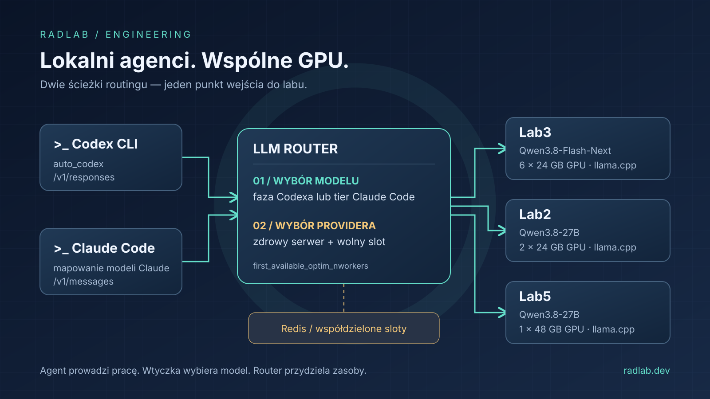

Witajcie! Dzisiaj technicznie. W [poprzednim wpisie o LLM Routerze](/2025-10-13/llm-router/) pokazaliśmy, jak oddzielić aplikację od miejsca, w którym uruchomiony jest model. Tym razem dokładamy kolejny klocek: **aplikacja nie musi nawet decydować, który model powinien obsłużyć konkretny etap pracy**.

Agent programistyczny nie robi przecież przez cały czas tego samego. Najpierw planuje zmianę, potem czyta kod, edytuje pliki, uruchamia testy i diagnozuje błędy. Po drodze generuje tytuł rozmowy, a kiedy kontekst się zapełni — przygotowuje jego skrót. Kierowanie wszystkiego do jednego modelu jest proste, ale rzadko jest rozsądnym wykorzystaniem lokalnych GPU.

W repozytorium [llm-router-plugins](https://github.com/radlab-dev-group/llm-router-plugins) rozwijamy dwie wtyczki, które podchodzą do tego problemu z dwóch stron: `agentic_routing_codex` i `agentic_routing_claude_code`. Poniżej pokazujemy, co naprawdę robią, jak je uruchomić i jak wykorzystujemy do tego trzy maszyny w naszym labie. Bez udawania, że zmiana nazwy modelu zamienia lokalnego Qwena w chmurowego Claude’a czy model OpenAI 🙂

## Login: najpierw uporządkujmy nazwy

W przypadku Codexa sprawa jest dosłowna: **`auto_codex` to domyślna nazwa-wyzwalacz**, którą klient wysyła w polu `model`. Wtyczka rozpoznaje rodzaj żądania i tryb pracy, a następnie podmienia tę nazwę na konkretny model.

Z Claude Code jest inaczej. Kiedy mówimy skrótowo „auto_claude”, mamy na myśli automatyczne mapowanie modeli Claude Code, ale **w dostarczonej konfiguracji nie ma specjalnego wyzwalacza `auto_claude`**. Wtyczka rozpoznaje nazwy i rodziny modeli, np. `claude-sonnet-*`, `claude-opus-*` czy `claude-haiku-*`, i przypisuje im lokalne odpowiedniki. Wysłanie samego `model: "auto_claude"` bez dodania odpowiedniej reguły niczego nie aktywuje. Dalej pokażemy, jak świadomie dodać taki alias, jeśli ktoś go potrzebuje.

| Cecha | Codex CLI | Claude Code |
| --- | --- | --- |
| Nazwa wtyczki w potoku | `agentic_routing_codex` | `agentic_routing_claude_code` |
| Co uruchamia decyzję | `model = "auto_codex"` | Dopasowanie przychodzącej nazwy modelu |
| Podstawa wyboru | Klasa żądania, tryb współpracy, faza pracy, heurystyki; opcjonalnie embeddingi | Tier, czyli skonfigurowana kategoria modelu |
| Klasyfikacja treści zadania | Tak, w określonych warstwach | Nie |
| FAISS i model embeddingowy | Opcjonalne | Niepotrzebne |
| Pamięć faz między żądaniami | Opcjonalna, w Redisie | Nie jest potrzebna do mapowania |

**To są wtyczki routera, a nie rozszerzenia instalowane w terminalowym agencie.** Działają po stronie serwera, w potoku narzędziowym (*utils*). Codex i Claude Code nadal odpowiadają za pętlę agenta, dostęp do plików, wykonywanie narzędzi i pytania o zgodę. Router wybiera model i providera, a jego warstwa API dba o zgodność protokołów.

## Trzy maszyny, dwa modele, jeden punkt wejścia

Nasza infrastruktura generatywna wygląda następująco. Wszystkie wymienione modele uruchamiamy przez **llama.cpp**:

| Maszyna | GPU | Model udostępniany routerowi |
| --- | --- | --- |
| Lab3 | 6 × 24 GB | `qwen/Qwen3.8-Flash-Next` |
| Lab2 | 2 × 24 GB | `qwen/Qwen3.8-27B` |
| Lab5 | 1 × 48 GB | `qwen/Qwen3.8-27B` |

Lab2 i Lab5 to **dwa osobne serwery tego samego modelu logicznego** — nie składamy z ich kart jednego rozproszonego modelu. Z kolei sześć kart Lab3 nie oznacza sześciu niezależnych instancji: jeden serwer llama.cpp rozkłada wagi między GPU.

```text
Codex CLI ── /v1/responses ──┐
                            ├── LLM Router (Gunicorn)
Claude Code ─ /v1/messages ──┘       │
                                    ├── wtyczka: wybór modelu logicznego
                                    │
                                    └── strategia: wybór providera i slotu
                                         ├── Lab3: Flash-Next, llama.cpp
                                         ├── Lab2: 27B, llama.cpp
                                         └── Lab5: 27B, llama.cpp
                                             │
                              Redis: współdzielona zajętość slotów
                              Redis: opcjonalna pamięć faz Codexa
```

Zapadają tu **dwie różne decyzje**. Wtyczka odpowiada na pytanie: „Flash-Next czy 27B?”. Dopiero strategia routera odpowiada: „jeżeli 27B, to Lab2 czy Lab5 — i czy jest tam wolny slot?”. Warto trzymać te poziomy osobno. Jeśli je pomieszamy, łatwo skończyć z konfiguracją, w której model jest dobierany inteligentnie, ale wszystkie żądania do 27B i tak ustawiają się w kolejce do jednego serwera, podczas gdy drugi stoi bezczynnie.

W przykładach poniżej `lab2`, `lab3` i `lab5` oznaczają nazwy DNS albo wpisy w lokalnym `/etc/hosts` — wewnętrznych adresów ani danych dostępowych nie publikujemy. Skrypty startowe llama.cpp, nazwy modeli i ich przypisanie do maszyn odpowiadają natomiast temu, co faktycznie działa w naszym labie.

## Karton z klockami: przygotowanie środowiska

Potrzebujemy działających serwerów llama.cpp, środowiska Pythona dla routera, pakietu wtyczek oraz Redisa dla strategii współbieżności. Router i wtyczki wymagają Pythona **3.10 lub nowszego** i powinny siedzieć w jednym środowisku.

Oba komponenty są dostępne na PyPI jako [`radlab-llm-router`](https://pypi.org/project/radlab-llm-router/) i [`radlab-llm-router-plugins`](https://pypi.org/project/radlab-llm-router-plugins/). Najprostsza ścieżka wygląda więc tak:

```bash
mkdir -p ~/llm-router-local && cd ~/llm-router-local
python3 -m venv .venv
source .venv/bin/activate
python -m pip install 'radlab-llm-router[api,metrics]'
python -m pip install 'radlab-llm-router-plugins[memory]'
mkdir -p local-config
```

Ten wariant wystarcza do routingu deterministycznego i opcjonalnej pamięci w Redisie. Wtyczka Claude Code nie potrzebuje embeddingów. Jeżeli chcemy uruchomić także semantyczną warstwę Codexa, do tego samego środowiska instalujemy:

```bash
python -m pip install 'radlab-llm-router-plugins[ml,memory]'
```

Dodatek `ml` instaluje m.in. `sentence-transformers` i `faiss-cpu`; wariant `ml-gpu` zamienia FAISS na wersję GPU. Nie instalujemy jednocześnie `faiss-cpu` i `faiss-gpu`. Co ważne, embeddingi w tej ścieżce są liczone na maszynie routera — GPU w labach zajmują się generacją. Jeżeli wdrożenie ma pracować bez dostępu do Internetu, model embeddingowy trzeba wcześniej pobrać.

Kto chce pracować na bieżących źródłach (albo coś we wtyczkach zmieniać), klonuje oba repozytoria obok siebie i zamiast nazw pakietów podaje `-e .` oraz `-e ../llm-router-plugins[...]`. W obu wariantach warto przypiąć wersje: dawno zainstalowany pakiet nie musi zawierać funkcji opisanych w aktualnej dokumentacji, a dokumentacja nie musi opisywać tego, co mamy zainstalowane.

### llama.cpp: zgodność API to dopiero początek

Na każdej maszynie mamy osobno zbudowane llama.cpp (`llama-server`) w wersji obsługującej dany model i jego format GGUF. Poniżej skrypty, którymi faktycznie startujemy backendy. Na **Lab3** sześć kart trzyma `Qwen3.8-Flash-Next` w kwantyzacji `UD-IQ4_XS`, podzielony na trzy pliki — llama.cpp dostaje ścieżkę do pierwszego z nich i sam dociąga resztę:

```bash
#!/bin/bash
export CUDA_VISIBLE_DEVICES=0,1,2,3,4,5

LLAMA_CPP_BIN=/mnt/data2/dev/apps/llama.cpp.lab3/build/bin/llama-server
MODEL_ALIAS=qwen/Qwen3.8-Flash-Next

MODEL_DIR=/mnt/local/llms/models/community/qwen/Qwen3.8-Flash-Next
MODEL_PATH=${MODEL_DIR}/UD-IQ4_XS/Qwen3.8-Flash-Next-UD-IQ4_XS-00001-of-00003.gguf
MMPROJ_PATH=${MODEL_DIR}/mmproj-BF16.gguf
TEMPLATE_FILE=${MODEL_DIR}/chat-template.jinja

CTX_SIZE=360000
PARALLEL=1

"${LLAMA_CPP_BIN}" \
    --model "${MODEL_PATH}" \
    --alias "${MODEL_ALIAS}" \
    --mmproj "${MMPROJ_PATH}" \
    --chat-template-file "${TEMPLATE_FILE}" \
    --ctx-size ${CTX_SIZE} \
    --parallel ${PARALLEL} \
    --n-gpu-layers 999 \
    --flash-attn on \
    --numa distribute \
    --tensor-split 1.1,1.1,1.1,1,1,1 \
    --batch-size 4086 \
    --ubatch-size 1024 \
    --host 0.0.0.0 \
    --port 7000
```

**Lab2** uruchamia `Qwen3.8-27B` w `UD-Q6_K_XL` na dwóch kartach:

```bash
#!/bin/bash
export CUDA_VISIBLE_DEVICES=0,1

LLAMA_CPP_BIN=/mnt/data2/dev/apps/llama.cpp.lab2/build/bin/llama-server
MODEL_ALIAS=qwen/Qwen3.8-27B

MODEL_DIR=/mnt/data2/llms/models/community/qwen/Qwen3.8-27B
MODEL_PATH=${MODEL_DIR}/Qwen3.8-27B-UD-Q6_K_XL.gguf
MMPROJ_PATH=${MODEL_DIR}/mmproj-BF16.gguf
TEMPLATE_FILE=${MODEL_DIR}/chat-template.jinja

"${LLAMA_CPP_BIN}" \
    --model "${MODEL_PATH}" \
    --alias "${MODEL_ALIAS}" \
    --mmproj "${MMPROJ_PATH}" \
    --chat-template-file "${TEMPLATE_FILE}" \
    --ctx-size 300000 \
    --parallel 1 \
    --n-gpu-layers 999 \
    --numa distribute \
    --flash-attn on \
    --batch-size 2048 \
    --ubatch-size 512 \
    --tensor-split 1,1 \
    --reasoning-budget 0.0 \
    --host 0.0.0.0 \
    --port 7000
```

**Lab5** to ten sam model i ta sama kwantyzacja, ale na jednej karcie 48 GB — nie ma więc `--tensor-split`, a batch jest mniejszy:

```bash
#!/bin/bash
export CUDA_VISIBLE_DEVICES=0

LLAMA_CPP_BIN=/mnt/data2/dev/apps/llama.cpp.lab5/build/bin/llama-server
MODEL_ALIAS=qwen/Qwen3.8-27B

MODEL_DIR=/mnt/data2/llms/models/community/qwen/Qwen3.8-27B
MODEL_PATH=${MODEL_DIR}/Qwen3.8-27B-UD-Q6_K_XL.gguf
MMPROJ_PATH=${MODEL_DIR}/mmproj-BF16.gguf
TEMPLATE_FILE=${MODEL_DIR}/chat-template.jinja

"${LLAMA_CPP_BIN}" \
    --model "${MODEL_PATH}" \
    --alias "${MODEL_ALIAS}" \
    --mmproj "${MMPROJ_PATH}" \
    --chat-template-file "${TEMPLATE_FILE}" \
    --ctx-size 360000 \
    --parallel 1 \
    --n-gpu-layers 999 \
    --flash-attn on \
    --batch-size 1024 \
    --ubatch-size 512 \
    --reasoning-budget 0.0 \
    --host 0.0.0.0 \
    --port 7000
```

Kilka rzeczy wartych komentarza, bo to one decydują o tym, jak zachowa się później agent:

- **`--alias`** jest nazwą, pod którą backend przedstawia model. Router będzie jej używał w `model_path`, więc na Lab2 i Lab5 alias jest **identyczny** — dla routera to jeden model logiczny z dwoma providerami.
- **`--parallel 1`** oznacza jeden slot generacji na serwer. Cały `--ctx-size` przypada wtedy na jedną sekwencję: 360 000 tokenów na Lab3 i Lab5, 300 000 na Lab2. Przy agentach wolimy pojedynczy slot z bardzo długim kontekstem niż kilka slotów, które po podziale nie udźwigną kompresji dużej rozmowy. Ta liczba wróci za chwilę jako `nworkers` w konfiguracji routera.
- **`--chat-template-file`** wskazuje szablon dostarczony z modelem. To od niego zależy, czy wywołania narzędzi są poprawnie serializowane i parsowane, a bez tego żaden agent nie zadziała. `--mmproj` dokłada projektor wizyjny — Codex i Claude Code potrafią przesyłać zrzuty ekranu.
- **`--reasoning-budget 0.0`** na obu instancjach 27B wyłącza rozbudowane „myślenie” modelu. Przy zadaniach pomocniczych (tytuł, kompresja, testy, Git) liczy się czas odpowiedzi, a Flash-Next na Lab3 zachowuje pełne rozumowanie dla planowania i debugowania.
- **`--tensor-split`** i `--numa distribute` rozkładają wagi między karty; na Lab3 pierwsze trzy GPU dostają odrobinę więcej (`1.1`), bo oprócz warstw trzymają dodatkowe bufory. `--n-gpu-layers 999` to po prostu „wszystko na GPU”.
- Te parametry to efekt strojenia, nie pierwszy strzał: na 27B próbowaliśmy też `UD-Q8_K_XL`, a na Lab3 `UD-Q4_K_XL` i kontekst `524288`. **Suma VRAM nie gwarantuje, że dowolna kwantyzacja z dowolnym kontekstem się zmieści** — każdą zmianę sprawdzamy na logach serwera, nie na kalkulatorze.

Zanim dołożymy router, sprawdzamy bezpośrednio na każdym backendzie zwykłą odpowiedź, strumieniowanie i pełną sekwencję: żądanie narzędzia → wynik narzędzia → kolejna odpowiedź. Jeśli to nie działa na porcie `7000`, nie zadziała też przez router.

## Konfiguracja routera: model nie jest adresem serwera

Poniższy plik — kompletny, choć ograniczony do tematu wpisu — zapisujemy jako `local-config/models.json` w katalogu roboczym routera. Dwa wpisy providerów dla 27B pozwalają routerowi korzystać z Lab2 i Lab5, a klient niczego z tego nie widzi.

```json
{
  "semantic_routing": {
    "auto_codex": {
      "providers": [
        {
          "id": "routing-auto-codex",
          "api_type": "builtin",
          "api_host": null,
          "api_token": "",
          "model_path": "",
          "input_size": 0,
          "tool_calling": true
        }
      ]
    }
  },
  "qwen_models": {
    "qwen/Qwen3.8-Flash-Next": {
      "providers": [
        {
          "id": "lab3-flash-next",
          "api_type": "llama.cpp",
          "api_host": "http://lab3:7000",
          "api_token": "",
          "model_path": "qwen/Qwen3.8-Flash-Next",
          "input_size": 256000,
          "tool_calling": true,
          "nworkers": 1
        }
      ],
      "fallback_model": "qwen/Qwen3.8-27B"
    },
    "qwen/Qwen3.8-27B": {
      "providers": [
        {
          "id": "lab2-qwen-27b",
          "api_type": "llama.cpp",
          "api_host": "http://lab2:7000",
          "api_token": "",
          "model_path": "qwen/Qwen3.8-27B",
          "input_size": 256000,
          "tool_calling": true,
          "nworkers": 1
        },
        {
          "id": "lab5-qwen-27b",
          "api_type": "llama.cpp",
          "api_host": "http://lab5:7000",
          "api_token": "",
          "model_path": "qwen/Qwen3.8-27B",
          "input_size": 256000,
          "tool_calling": true,
          "nworkers": 1
        }
      ]
    }
  },
  "active_models": {
    "semantic_routing": ["auto_codex"],
    "qwen_models": ["qwen/Qwen3.8-Flash-Next", "qwen/Qwen3.8-27B"]
  }
}
```

`model_path` to nazwa przekazywana backendowi; w tym przykładzie odpowiada `--alias` llama.cpp. `api_type: "llama.cpp"` wybiera właściwy adapter routera. Puste `api_token` zakłada backend dostępny wyłącznie w chronionej sieci; jeśli włączamy autoryzację backendu, token uzupełniamy w konfiguracji wdrożenia, a nie w repozytorium.

`tool_calling: true` deklaruje obsługę narzędzi, ale nie dodaje modelowi tej umiejętności. `input_size` opisuje budżet kontekstu widziany przez router — nie powiększa KV cache. Deklarujemy `256000`, czyli **mniej niż `--ctx-size` najsłabszego providera** (300 000 na Lab2): różnica to rezerwa na odpowiedź modelu, instrukcje systemowe i definicje narzędzi. Gdyby któryś backend startował z mniejszym kontekstem, to on wyznaczałby wartość dla całego modelu logicznego.

`fallback_model` odtwarza kolejny element naszej konfiguracji: model 27B jest zapasową ścieżką dla Flash-Next. To fallback na poziomie routera, uruchamiany, gdy nie uda się znaleźć dostępnego providera — a nie obietnica ponowienia każdej nieudanej generacji. Nie mylimy go z `fallback_mode` wtyczki Codexa, który określa tryb pracy przy braku rozstrzygnięcia klasyfikatora. W logach warto więc rozróżniać model wybrany przez wtyczkę od modelu, który ostatecznie obsłużył żądanie.

Alias `auto_codex` z providerem `builtin` jest punktem wejścia do routingu, nie kolejnym modelem generatywnym. Istnieć i być aktywne muszą przede wszystkim wszystkie docelowe nazwy z konfiguracji wtyczek. W aktualnej ścieżce API wtyczki działają przed rozwiązaniem docelowego modelu, ale jawne zadeklarowanie aliasu upraszcza publikowanie konfiguracji i współpracę z klientami.

### Dlaczego first_available_optim_nworkers?

W naszym wdrożeniu router pracuje ze strategią **`first_available_optim_nworkers`**. Przy kilku równoległych żądaniach od agentów ważne jest nie tylko to, czy host odpowiada, ale ile generacji możemy mu jeszcze przekazać.

Pole nazywa się dokładnie **`nworkers`**. To limit slotów providera w tej strategii — nie liczba procesów Gunicorna, kart GPU ani agentów. U nas każdy serwer llama.cpp startuje z `--parallel 1`, dlatego wszędzie stoi `nworkers: 1` — także na Lab3 z sześcioma kartami. Gdybyśmy podnieśli `--parallel`, w tym samym kroku zmienilibyśmy `nworkers`; rozjazd między tymi liczbami oznacza albo kolejkę na backendzie, albo niewykorzystane sloty.

Strategia wybiera zdrowego providera z wolnym slotem i najmniejszą **bezwzględną liczbą zajętych slotów**. Przy remisie preferuje ostatnio używany host, a następnie kolejność z konfiguracji. Nie jest to ważony round-robin ani porównanie procentowego wykorzystania GPU. Gdy oba serwery 27B są zajęte, router czeka na wolny slot do upływu limitu czasu — nie tworzy dodatkowej pojemności.

Zajętość jest współdzielona przez Redis, więc cztery procesy Gunicorna nie mają czterech sprzecznych obrazów wolnych miejsc. Rezerwacje slotów są odnawianymi dzierżawami. U nas działa to z `LLM_ROUTER_LB_SLOT_LEASE_SECONDS=120`, limitem odnawiania `LLM_ROUTER_LB_SLOT_MAX_AGE_SECONDS=1800` i TTL przypięcia hosta `LLM_ROUTER_LB_HOST_PIN_TTL_SECONDS=3600`. Przy kontekście rzędu 300 000 tokenów pojedyncza kompresja rozmowy potrafi trwać długo, więc te wartości trzeba dobrać do rzeczywistego czasu generacji: wygaśnięcie rezerwacji nie oznacza, że backend skończył pracę.

Pozostałe strategie mają inne zadania: `balanced` wybiera najmniej używanego providera, `weighted` korzysta z wag, `dynamic_weighted` pozwala je aktualizować, `first_available` szuka pierwszego wolnego providera, a `first_available_optim` dodatkowo preferuje hosty, które mają już załadowany model. **Samo dopisanie `nworkers` przy strategii `balanced` nie daje limitu slotów.** Nie mieszamy też wariantów `first_available_optim` i `first_available_optim_nworkers` dla tych samych modeli i tej samej bazy Redis — nie współdzielą mechanizmu blokad.

## auto_codex: agent zmienia zajęcie, router zmienia model

Wtyczka analizuje żądania w formacie OpenAI Responses wysyłane przez Codex CLI. Nie sprowadza się to do sprawdzenia, czy gdzieś w rozmowie padło słowo „test”. Wtyczka rozdziela **klasę żądania** od **trybu pracy**.

Klasy są trzy: zwykła tura `main`, pomocnicze tworzenie tytułu `aux_title` oraz kompresja kontekstu `compaction`. Klasyfikacja strukturalna daje pierwszeństwo kompresji przed tytułem. Dzięki temu długa historia pełna opisów awarii nie kieruje technicznego streszczenia do modelu „od debugowania”.

W aktualnym pliku `agentic_routing_codex.json` mapowanie jest następujące:

| Tryb | Zadanie | Model |
| --- | --- | --- |
| `plan` | Planowanie, m.in. jawny Plan Mode klienta | Flash-Next na Lab3 |
| `implement` | Implementacja; także domyślny tryb awaryjny klasyfikacji | Flash-Next na Lab3 |
| `review` | Przegląd kodu | Flash-Next na Lab3 |
| `debug` | Diagnozowanie i naprawianie błędów | Flash-Next na Lab3 |
| `test` | Praca nad testami i ich uruchamianie | 27B na Lab2 lub Lab5 |
| `git_review` | Praca z historią, diffem i operacjami Git | 27B na Lab2 lub Lab5 |
| `aux_title` | Krótki tytuł wątku | 27B na Lab2 lub Lab5 |
| `compaction` | Kompresja kontekstu rozmowy | 27B na Lab2 lub Lab5 |

To **nasza polityka przydziału**, nie uniwersalny ranking modeli. Testy, kompresję czy przegląd kodu można przypisać inaczej. Warto też pamiętać, że wygenerowanie polecenia uruchamiającego testy jest pracą modelu, ale samo ich wykonanie pozostaje po stronie narzędzi agenta.

### Kaskada zamiast dodatkowego dużego LLM-a

Decyzja zapada w ustalonej kolejności; pierwsza warstwa dająca poprawną odpowiedź wygrywa:

1. **Jawny tryb** w `agent_mode`, `codex_mode` albo `metadata.agent_mode`, jeśli wskazuje skonfigurowany tryb.
2. **Klasa żądania** — kompresja lub tytuł.
3. **Plan Mode** z bloku `<collaboration_mode>` przekazanego przez klienta.
4. **Bieżąca faza** wynikająca z konkretnych działań asystenta i wywołań narzędzi.
5. **Zapamiętana faza**, jeśli włączono współdzieloną pamięć i jest wiarygodna dla tej tury.
6. **Heurystyki** dla `test`, `git_review`, `review`, `debug`.
7. **Opcjonalne podobieństwo embeddingowe**.
8. **Fallback**, domyślnie `implement`.

Planowania nie wybiera sama heurystyka słów kluczowych. Jawny Plan Mode jest sygnałem strukturalnym, a zdanie o planowaniu w zwykłym trybie może zostać rozpoznane semantycznie. Ma to znaczenie, gdy chcemy zrozumieć, dlaczego dwa podobne zdania trafiły do różnych modeli.

Warstwa faz rozpoznaje np. faktyczne uruchomienie `pytest` czy `git diff`, wywołanie narzędzia nakładającego patch oraz wynik powiązany z konkretnym wywołaniem. Sama obecność narzędzia na liście `tools` nie oznacza, że zostało wykonane. `git status` jest neutralne, a stary błąd sprzed nowego polecenia użytkownika nie powinien definiować nowej fazy. Aktualny konfig analizuje okno ośmiu mocnych sygnałów, więc nie należy oczekiwać przełączenia po każdym pojedynczym pomocniczym poleceniu.

Heurystyki sumują dopasowania słów, fraz i wzorców, odrzucając powtórzenia oraz lokalne negacje rozpoznane regułami PL/EN. Potrzebny jest zarówno minimalny wynik, jak i przewaga nad drugim trybem; remisu nie rozstrzyga kolejność wpisów. To nadal reguły, nie pełne rozumienie języka: „nie uruchamiaj testów” i „testy nie działają” znaczą co innego, ale nie obiecujemy idealnego rozpoznania każdej negacji.

Warstwa semantyczna korzysta z opisów i przykładów trybów. Buduje indeks FAISS i porównuje embedding bieżącej intencji oraz ograniczonego kontekstu fazy. W aktualnym JSON-ie próg wynosi `0.44`, `top_k` to `4`, agregacja to `per_target_top_k`, a konfiguracja zawiera też marginesy przewagi. **To wartości startowe konkretnej konfiguracji, nie zmierzona skuteczność.** Gdy podobieństwo lub przewaga nie wystarczają, pozostaje fallback. Warstwy deterministyczne nie wymagają w ogóle wywołania embeddera.

### Własna konfiguracja bez przepisywania setek reguł

Nie warto kopiować z artykułu szczątkowego JSON-a i zakładać, że brakujące pola „same się uzupełnią”. Własny konfig musi zawierać komplet wymaganych obiektów, m.in. reguły faz, wagi heurystyk i ustawienia semantyczne. Najbezpieczniej zacząć od **pliku z tej samej wersji pakietu**, którą uruchamiamy:

```bash
PLUGINS_RES=$(python -c 'import llm_router_plugins, os; print(os.path.join(os.path.dirname(llm_router_plugins.__file__), "resources", "routing"))')
cp "${PLUGINS_RES}/agentic_routing_codex.json" local-config/codex.json
cp "${PLUGINS_RES}/agentic_routing_claude_code.json" local-config/claude-code.json

export LLM_ROUTER_ROUTING_SEMANTIC_AGENTIC_CODEX_CONFIG="$PWD/local-config/codex.json"
export LLM_ROUTER_ROUTING_SEMANTIC_AGENTIC_CLAUDE_CODE_CONFIG="$PWD/local-config/claude-code.json"
```

Przy instalacji z PyPI pliki leżą wewnątrz zainstalowanego pakietu, stąd powyższy jednolinijkowiec; przy pracy ze źródeł można skopiować je wprost z `../llm-router-plugins/llm_router_plugins/resources/routing/`.

Mapowanie modeli z tych plików pasuje do powyższego `models.json`. Możemy je zmienić przez JSON albo zmienne środowiskowe, np.:

```bash
export LLM_ROUTER_ROUTING_SEMANTIC_AGENTIC_CODEX_MODEL_TEST='qwen/Qwen3.8-27B'
export LLM_ROUTER_ROUTING_SEMANTIC_AGENTIC_CODEX_MODEL_DEBUG='qwen/Qwen3.8-Flash-Next'
```

Uwaga na podobne nazwy: `..._MODEL_DEBUG` wskazuje **model generatywny**, natomiast samo `..._MODEL` — **model embeddingowy**. Zmienne środowiskowe nadpisują JSON w momencie tworzenia wtyczki. Zmiana pliku wymaga więc odtworzenia wtyczki, czyli w praktyce restartu procesów routera; pliki nie są czytane przy każdym żądaniu.

### Pamięć faz to nie pamięć rozmowy

Bez pamięci routing korzysta wyłącznie z tego, co klient przesłał w bieżącym żądaniu. Przy przyrostowych payloadach może zabraknąć wywołania narzędzia, do którego odnosi się właśnie otrzymany wynik. Opcjonalny Redis pozwala przenieść wiarygodny stan fazy między żądaniami i procesami Gunicorna.

To nie jest baza kodu ani historia rozmów. Rekord przechowuje ograniczone identyfikatory, fazę, rodzaj dowodu i wersję; nie zapisuje treści rozmowy, wyjścia narzędzi ani poświadczeń. TTL domyślnie wynosi `900` sekund. Nowe polecenie użytkownika rozpoczyna nową generację, a świeże dowody mają pierwszeństwo przed zapamiętaną fazą. Osobny mechanizm stabilizuje zaakceptowaną decyzję semantyczną, żeby drobne wahania rankingu nie powodowały ciągłego przełączania modeli.

Połączenie z pamięcią konfiguruje się **osobnym prefiksem** `LLM_ROUTER_ROUTING_SEMANTIC_AGENTIC_CODEX_REDIS_*`. Ustawienie `LLM_ROUTER_REDIS_HOST` dla load balancingu nie włącza automatycznie pamięci Codexa. Awaria pamięci ma prowadzić do pracy bezstanowej, a nie do zatrzymania routingu — to inne wymaganie niż dostępność Redisa, od którego zależy strategia slotów.

## Claude Code: centralna zamiana modeli, nie drugi klasyfikator faz

Druga wtyczka jest celowo prostsza. Claude Code wybiera kategorię modelu, a router przypisuje jej to, co rzeczywiście mamy lokalnie. Dostarczony konfig kieruje `fable`, `opus` i `plan` do Flash-Next, natomiast `sonnet` i `haiku` do 27B. Lista tierów i identyfikatorów jest polityką wtyczki — nie gwarancją, że dana wersja klienta używa każdej z tych nazw.

W praktyce najważniejsze są rodziny Opus, Sonnet i Haiku. Żądania subagentów trafiają do kategorii wynikającej z nazwy modelu, którą faktycznie wysłał klient. Nie ma tu analizy treści zadania, która miałaby stwierdzić „teraz debugujemy”.

Najpierw następuje normalizacja nazwy, m.in. usunięcie rozpoznanych prefiksów dostawców, rewizji i sufiksów kontekstu. Potem dopasowanie przebiega od najbardziej szczegółowego do najogólniejszego:

1. Dosłowny wpis, np. konkretna wersja Sonnet.
2. Zgodność po normalizacji.
3. Wildcard z końcową gwiazdką, np. `claude-opus-*`; dłuższy prefiks ma pierwszeństwo.
4. Rozpoznanie rodziny dla odpowiednio zadeklarowanych wzorców.

Możemy więc utrzymywać jedno mapowanie na serwerze zamiast rozprowadzać zmienne `ANTHROPIC_DEFAULT_*_MODEL` po wszystkich laptopach i runnerach CI. **Nazwa Opus w interfejsie klienta nie oznacza, że pod spodem pracuje model Anthropic** — w naszym przykładzie pracuje Qwen. To mapowanie infrastruktury, a nie emulacja jakości, licencji, możliwości czy pojemności kontekstu oryginalnego modelu.

Podobnie z `opusplan`: klient zwykle rozwiązuje ten alias samodzielnie. Jeżeli do routera dotrze już nazwa modelu Opus, zadziała tier `opus`. Wpis `plan` jest zabezpieczeniem na wypadek nierozwiązanego aliasu, a nie wykrywaniem trybu planowania z treści wiadomości.

Przykład centralnej zmiany mapowania:

```bash
export LLM_ROUTER_ROUTING_SEMANTIC_AGENTIC_CLAUDE_CODE_MODEL_OPUS='qwen/Qwen3.8-Flash-Next'
export LLM_ROUTER_ROUTING_SEMANTIC_AGENTIC_CLAUDE_CODE_MODEL_SONNET='qwen/Qwen3.8-27B'
export LLM_ROUTER_ROUTING_SEMANTIC_AGENTIC_CLAUDE_CODE_MODEL_HAIKU='qwen/Qwen3.8-27B'
```

Jeśli koniecznie chcemy własną nazwę **`auto_claude`**, możemy dopisać ją do tablicy `models` wybranego tieru w `local-config/claude-code.json`. Przykładowo, używając `jq`:

```bash
jq '(.claude_code_modes[] | select(.name == "sonnet") | .models) += ["auto_claude"]' \
  local-config/claude-code.json > local-config/claude-code-alias.json
export LLM_ROUTER_ROUTING_SEMANTIC_AGENTIC_CLAUDE_CODE_CONFIG="$PWD/local-config/claude-code-alias.json"
```

Od tej chwili żądanie z taką nazwą trafi do tieru `sonnet`. **To stałe przypisanie, nie odpowiednik klasyfikatora Codexa.** Podstawowy wariant z oryginalnymi nazwami Claude Code zachowuje więcej informacji o intencji klienta i nie wymaga, żeby klient akceptował dowolny własny alias. Dlatego od niego zaczynamy.

## Uruchomienie: środowisko routera

Router uruchamiamy skryptem `run-rest-api-gunicorn.sh` z repozytorium; przy instalacji z PyPI wystarczy pobrać sam skrypt albo wywołać bezpośrednio `llm-router server start -i "$LLM_ROUTER_INSTANCE"` w przygotowanym środowisku. Skrypt ustawia zmienne, wywołuje `llm-router server start -i ...` i podłącza podgląd logów. Domyślna nazwa instancji to `localhost-dev`, port `8081`, liczba procesów Gunicorna `4`, a liczba wątków `16`. Timeout serwera wynosi `0`, a zewnętrznych wywołań `300` sekund — **nie oznacza to nieskończonego czasu działania całego łańcucha**, bo pozostają limity backendu, strategii i reverse proxy.

Przykładowe ustawienia dla przygotowanych wcześniej plików, wykonywane nadal w katalogu roboczym z `local-config/` i w aktywnym środowisku:

```bash
export LLM_ROUTER_INSTANCE='local-agents'
export LLM_ROUTER_MODELS_CONFIG="$PWD/local-config/models.json"
export LLM_ROUTER_UTILS_PLUGINS_PIPELINE='agentic_routing_codex,agentic_routing_claude_code'
export LLM_ROUTER_BALANCE_STRATEGY='first_available_optim_nworkers'

export LLM_ROUTER_SERVER_TYPE='gunicorn'
export LLM_ROUTER_SERVER_HOST='127.0.0.1'
export LLM_ROUTER_SERVER_PORT=8081
export LLM_ROUTER_SERVER_WORKERS_COUNT=4
export LLM_ROUTER_SERVER_THREADS_COUNT=16
export LLM_ROUTER_TIMEOUT=0
export LLM_ROUTER_EXTERNAL_TIMEOUT=300
export LLM_ROUTER_IN_DEBUG=0
export LLM_ROUTER_VERBOSE=0

# Redis dostępny dla wszystkich procesów routera.
export LLM_ROUTER_REDIS_HOST='127.0.0.1'
export LLM_ROUTER_REDIS_PORT=6379
export LLM_ROUTER_REDIS_DB=0
export LLM_ROUTER_REDIS_PROTOCOL=2

# Zaczynamy deterministycznie, bez pobierania embeddera przy starcie.
export LLM_ROUTER_ROUTING_SEMANTIC_AGENTIC_CODEX_SEMANTIC_ENABLED=false
export LLM_ROUTER_ROUTING_SEMANTIC_AGENTIC_CODEX_MEMORY_ENABLED=true
export LLM_ROUTER_ROUTING_SEMANTIC_AGENTIC_CODEX_REDIS_HOST='127.0.0.1'
export LLM_ROUTER_ROUTING_SEMANTIC_AGENTIC_CODEX_REDIS_PORT=6379
export LLM_ROUTER_ROUTING_SEMANTIC_AGENTIC_CODEX_REDIS_DB=1
export LLM_ROUTER_ROUTING_SEMANTIC_AGENTIC_CODEX_REDIS_PROTOCOL=2

export LLM_ROUTER_AUTH_ENABLED=true
export LLM_ROUTER_AUTH_KEY_STORE='redis'
export LLM_ROUTER_AUTH_REDIS_HOST='127.0.0.1'
export LLM_ROUTER_AUTH_REDIS_PORT=6379
export LLM_ROUTER_AUTH_REDIS_DB=2
export LLM_ROUTER_AUTH_REDIS_PROTOCOL=2
```

Redis musi już działać. Osobne bazy `0`, `1` i `2` to przykładowy podział w ramach jednej instancji; równie dobrze można użyć osobnych instancji. Hasła, ACL i TLS dobieramy do wdrożenia, bez umieszczania sekretów w repozytorium. Rozdzielenie konfiguracji ma znaczenie: load balancing, auth i pamięć wtyczki nie dziedziczą po sobie parametrów.

Zanim podłączymy klienta, tworzymy klucz routera w tym samym magazynie auth:

```bash
llm-router auth key generate --store redis --policy developer
```

Polecenie korzysta z ustawionych wyżej zmiennych `LLM_ROUTER_AUTH_REDIS_*`. Wygenerowany sekret zapisujemy w menedżerze sekretów i przekazujemy klientowi; polityka musi dopuszczać endpointy Responses (`chat`) i Anthropic (`anthropic`) oraz używane modele. To **klucz wejściowy routera**, nie token llama.cpp. Lokalnego dla procesu magazynu `memory` nie używamy jako współdzielonego magazynu dla czterech workerów.

Start:

```bash
bash ./run-rest-api-gunicorn.sh
```

Ścieżki `..._CONFIG` muszą być ustawione wcześniej, tak jak w sekcji o kopiowaniu plików, a wszystkie procesy muszą mieć do nich dostęp. Skrypt stosuje wartości domyślne przez `${ZMIENNA:-wartość}`, więc **pusty tekst nie zawsze wyłącza funkcję** — dla wartości logicznych podajemy jawnie `false` albo `0`. Liczy się końcowe środowisko procesu, nie komentarz w pliku konfiguracyjnym: pamięć Codexa jest w domyślnym JSON-ie pakietu wyłączona, ale powyższe zmienne ją włączają.

Przy dostępie spoza hosta wystawiamy router przez reverse proxy z TLS, poprawną obsługą SSE i timeoutami. Nie otwieramy bez potrzeby portów llama.cpp ani Redisa na świat. `LLM_ROUTER_VERBOSE=1` zapisuje w logach surowe parametry żądań i nie jest rozsądnym ustawieniem produkcyjnym.

### A jeśli chcemy semantykę?

Po zainstalowaniu dodatku `ml` ustawiamy ścieżkę do zaufanego modelu embeddingowego i restartujemy instancję z nowym środowiskiem:

```bash
export LLM_ROUTER_ROUTING_SEMANTIC_AGENTIC_CODEX_SEMANTIC_ENABLED=true
export LLM_ROUTER_ROUTING_SEMANTIC_AGENTIC_CODEX_MODEL='/srv/models/google/embeddinggemma-300m'
```

Domyślny plik z repozytorium wtyczek zawiera lokalną ścieżkę embeddera, która na innym komputerze nie musi istnieć — trzeba ją nadpisać. Każdy proces tworzy własną instancję wtyczki, więc koszt RAM i inicjalizacji embeddera uwzględniamy przy doborze liczby workerów. Loader dopuszcza `trust_remote_code=True`, dlatego korzystamy wyłącznie ze sprawdzonych źródeł modelu. Utrwalony indeks i docstore również powinny pochodzić z zaufanego miejsca.

Po zmianie opisów, przykładów, zestawu trybów lub modelu embeddingowego przebudowujemy indeks. Progi dobieramy na własnych śladach pracy, rozdzielając sesje kalibracyjne i walidacyjne. Dobrą miarą nie jest wyłącznie zgodność pojedynczej etykiety, ale też stabilność przejść między fazami, opóźnienie decyzji i wpływ na jakość końcowej pracy agenta.

## Podpinamy klientów

### Codex CLI

W `~/.codex/config.toml` ustawiamy własnego providera Responses. Limity odpowiadają `input_size` z konfiguracji routera, a nie temu, co deklaruje pojedynczy najmocniejszy backend:

```toml
model = "auto_codex"
model_provider = "llm_router"
model_context_window = 256000
model_max_output_tokens = 32768

[model_providers.llm_router]
name = "LLM Router"
base_url = "http://127.0.0.1:8081/v1"
wire_api = "responses"
env_key = "LLM_ROUTER_API_KEY"
```

W środowisku klienta ustawiamy `LLM_ROUTER_API_KEY` na utworzony wcześniej klucz i uruchamiamy `codex`. Skoro router może zmienić model między żądaniami, wspólnym kontraktem musi być **najmniejszy budżet spośród modeli docelowych** — u nas wyznacza go Lab2 z `--ctx-size 300000`, po odjęciu rezerwy na odpowiedź, instrukcje i definicje narzędzi. Gdybyśmy dołożyli backend z mniejszym kontekstem, ta wartość musiałaby spaść razem z nim.

`wire_api = "responses"` jest istotne: wtyczka oczekuje struktury żądań Codexa, a nie dowolnego tekstu z endpointu czatu. Plan Mode i metadane klienta dostarczają sygnałów, których zwykły prompt nie zastąpi.

### Claude Code

W terminalu klienta ustawiamy:

```bash
export ANTHROPIC_BASE_URL='http://127.0.0.1:8081'
export ANTHROPIC_AUTH_TOKEN="$LLM_ROUTER_API_KEY"
claude
```

Zakładamy, że `LLM_ROUTER_API_KEY` ma również uprawnienie Anthropic. Używamy **adresu bazowego bez `/anthropic`**: w opisywanej wersji routera Messages jest dostępne pod literalnym `POST /v1/messages`, a Responses pod `/v1/responses` (także `/responses`). Globalny `LLM_ROUTER_EP_PREFIX=/api` nie dodaje `/api` do tych zgodnościowych endpointów.

Nazwy modeli Claude Code zostawiamy w rodzinach skonfigurowanych we wtyczce, zamiast ustawiać wszystkie zmienne tierów na tę samą nazwę Qwena — w przeciwnym razie sami usuwamy informację, którą wtyczka miała wykorzystać. Wersja klienta nadal ma znaczenie: sprawdzamy, jak obsługuje własny endpoint, narzędzia i limity kontekstu. Sufiks typu `[1m]` zostanie znormalizowany przy dopasowaniu, ale **nie da lokalnemu modelowi miliona tokenów kontekstu**.

## Coś dla oka: jak sprawdzić efekt

Najpierw sprawdzamy backendy, potem wtyczki, na końcu klientów. Nie zaczynamy od wielogodzinnego zadania w agencie, bo wtedy trudno ustalić, na której warstwie pojawił się problem.

Prosty test Responses z jawnym trybem, bez polegania na heurystykach:

```bash
curl --fail-with-body http://127.0.0.1:8081/v1/responses \
  -H "Authorization: Bearer $LLM_ROUTER_API_KEY" \
  -H 'Content-Type: application/json' \
  -d '{"model":"auto_codex","agent_mode":"plan","input":"Zaplanuj dodanie endpointu health, bez edytowania plików.","stream":false}'
```

Przykładowa decyzja w logu, nie wynik benchmarku:

```text
Codex routing: mode=plan source=explicit model=qwen/Qwen3.8-Flash-Next similarity=1.000 class=main
```

Wtyczka ustawia `model`, `agent_mode` i metadane `routing`, m.in. źródło decyzji i klasę żądania. Treści zadania, narzędzi ani instrukcji nie przepisuje. `routing` służy diagnostyce — nie zakładamy, że ten wewnętrzny obiekt wróci w odpowiedzi API do klienta.

Test mapowania Claude Code:

```bash
curl --fail-with-body http://127.0.0.1:8081/v1/messages \
  -H "x-api-key: $LLM_ROUTER_API_KEY" \
  -H 'anthropic-version: 2023-06-01' \
  -H 'Content-Type: application/json' \
  -d '{"model":"claude-sonnet-4-5","max_tokens":128,"messages":[{"role":"user","content":"Odpowiedz krótko: czym jest routing modeli?"}]}'
```

Przy opisanym mapowaniu oczekujemy decyzji:

```text
Claude Code model swap: claude-sonnet-4-5 -> qwen/Qwen3.8-27B (mode=sonnet, matched=claude-sonnet-4-5, match_type=literal, field=model)
```

`similarity=1.0` przy regule deterministycznej **nie jest prawdopodobieństwem poprawności**. Dla Claude Code to stała opisująca dopasowanie, dla heurystyk Codexa wynik ma inną skalę, a dla warstwy semantycznej jest podobieństwem kosinusowym. Nie porównujemy ich jako jednej miary pewności.

Docelowo sprawdzamy też pełną sesję: Plan Mode → edycja → testy → diagnoza błędu, do tego pomocniczy tytuł i kompresję kontekstu. W logach backendów i routera weryfikujemy osobno model i host. Dwoma równoległymi żądaniami do 27B można sprawdzić rozdział slotów Lab2/Lab5, ale jednej krótkiej próby nie traktujemy jak testu przepustowości. Potrzebne są też długie streamy, rozłączenie klienta, niedostępność jednego backendu i przekroczenie pojemności wszystkich slotów.

### Gdy nie działa

| Objaw | Co sprawdzić |
| --- | --- |
| `auto_codex` nie zmienia się na model docelowy | Czy pakiet jest zainstalowany w środowisku serwera, potok zawiera wtyczkę, a trigger jest zgodny |
| Brak zamiany modelu Claude Code i brak logu | Czy nazwa pasuje do tieru; niedopasowanie jest celowo cichym przepuszczeniem |
| `model not found` po decyzji wtyczki | Czy model docelowy istnieje i jest aktywny w `models.json` |
| Błąd startu własnego configu | Kompletność wymaganych pól, powtórzone tryby, niepoprawne wzorce i fallback wskazujący istniejący tryb |
| `401` albo `403` | Magazyn kluczy, uprawnienia endpointu/modelu; nie token providera |
| `404` na Messages | Czy wywołujemy `/v1/messages`, bez nieobsługiwanego prefiksu |
| Żądania przekraczają realną pojemność backendu | Zgodność `nworkers`, `--parallel`, limitów kontekstu i wybranej strategii |
| Pamięć Codexa nie działa mimo działającego load balancingu | Osobne zmienne Redis wtyczki i diagnostyka `routing.memory` |
| Działa zwykły tekst, ale nie agent | Szablon narzędzi, kodowanie argumentów, powiązanie wyników, SSE i kompatybilność wersji klienta |

Wtyczki działają w trybie **fail-open**: niepasujący lub nierozpoznany payload przepuszczają bez zmian. Nie znaczy to, że „zawsze otrzymamy poprawną odpowiedź”. Nierozwiązany alias może nie wskazywać żadnego generatywnego providera, a nieistniejący model docelowy spowoduje błąd na dalszym etapie. Wymagana konfiguracja routingu jest walidowana przy tworzeniu wtyczki; błędy opcjonalnej pamięci wyłączają natomiast samą pamięć, nie cały routing.

## Czym to się wyróżnia w lokalnym świecie agentów?

Samo podłączenie CLI do serwera zgodnego z OpenAI czy Anthropic nie jest już szczególną sztuką. Różnica zaczyna się wtedy, gdy **wiele osób, kilka modeli i kilka maszyn ma działać jak jeden przewidywalny system**.

Po pierwsze, polityka jest **centralna**. Przydział modelu zmieniamy na routerze, zamiast poprawiać konfigurację każdego laptopa. Codex nadal wysyła `auto_codex`, a Claude Code zachowuje własne nazwy tierów.

Po drugie, Codex dostaje routing świadomy **struktury pracy agenta**, a nie tylko treści pierwszego promptu. Tytuł wątku i kompresja kontekstu nie muszą konkurować o ten sam backend co trudna diagnoza. Claude Code z kolei dostaje prostą, audytowalną politykę mapowania — bez klasyfikatora, którego nie potrzebuje.

Po trzecie, wybór modelu jest oddzielony od **zarządzania pojemnością**. Wspólne sloty w Redisie pozwalają wielu procesom routera korzystać z Lab2 i Lab5 według jednego obrazu zajętości. To ważniejsze niż kolejna nazwa modelu na liście.

Po czwarte, możemy zacząć od reguł bez kolejnego wywołania dużego modelu, a embeddingi i kalibrację dołożyć później. Źródło decyzji pozostaje widoczne. Nie obiecujemy „zerowego kosztu”: są koszty CPU, RAM, Redisa i inicjalizacji, a przy semantyce także kodowania zapytań.

Są też ograniczenia. **Podmiana modelu nie przenosi jego ukrytego stanu ani cache’u KV.** Nowy backend dostaje kontekst przekazany protokołem; nie przejmuje pamięci poprzedniej generacji. Zmiana modelu lub hosta może zwiększyć koszt przetworzenia promptu i pogorszyć spójność zachowania. Dlatego mierzymy całe zadanie: poprawność zmian, skuteczność narzędzi, liczbę tur, opóźnienia i wykorzystanie GPU, a nie tylko szybkość pojedynczego tokenu.

Lokalne modele dają kontrolę nad miejscem inferencji, ale nie izolują automatycznie całego środowiska. Agent może uruchamiać polecenia, pobierać zależności i łączyć się z usługami zewnętrznymi. Nadal potrzebujemy sandboxa, kontroli uprawnień, ochrony sekretów i świadomego logowania. Wtyczka routingu nie jest mechanizmem bezpieczeństwa ani zastępstwem zatwierdzania operacji.

## Logout

Nie budujemy kolejnego agenta, który zastąpi wszystkie pozostałe. Dokładamy warstwę, która pozwala **istniejącym agentom korzystać z naszej infrastruktury w bardziej uporządkowany sposób**: Codex dobiera model do fazy pracy, Claude Code korzysta z centralnego mapowania tierów, a router zarządza miejscem i współbieżnością wykonania.

U nas sprowadza się to do trzech maszyn, dwóch modeli logicznych i jednego punktu wejścia. U kogoś innego może to być na początek jeden serwer — ważne, żeby role konfiguracji były rozdzielone i dało się prześledzić każdą decyzję. Kolejne klocki można dokładać później 🙂

Kod udostępniamy na licencji Apache 2.0. Zachęcamy do korzystania, zgłaszania problemów i dzielenia się własnymi konfiguracjami. Dokumentacja do dalszego czytania:

- [LLM Router — repozytorium](https://github.com/radlab-dev-group/llm-router), [pakiet `radlab-llm-router` na PyPI](https://pypi.org/project/radlab-llm-router/) i [opis projektu](/products/llm-router/).
- [Wtyczki — repozytorium](https://github.com/radlab-dev-group/llm-router-plugins) i [pakiet `radlab-llm-router-plugins` na PyPI](https://pypi.org/project/radlab-llm-router-plugins/).
- [Routing Codex CLI — konfiguracja i diagnostyka](https://github.com/radlab-dev-group/llm-router-plugins/blob/main/llm_router_plugins/utils/routing/agentic_routing/codex/README.md).
- [Mapowanie Claude Code](https://github.com/radlab-dev-group/llm-router-plugins/blob/main/llm_router_plugins/utils/routing/agentic_routing/claude_code/README.md).
- [Strategie load balancingu](https://github.com/radlab-dev-group/llm-router/blob/main/llm_router_api/docs/LB_STRATEGIES.md) i [schemat konfiguracji modeli](https://github.com/radlab-dev-group/llm-router/blob/main/llm_router_api/docs/MODELS_CONFIG.md).

Opis odpowiada stanowi źródeł z 27 października 2026 r. Publiczne gałęzie i wersje klientów rozwijają się niezależnie — przy odtwarzaniu wdrożenia porównujemy dokumentację z faktycznie zainstalowanymi wersjami.